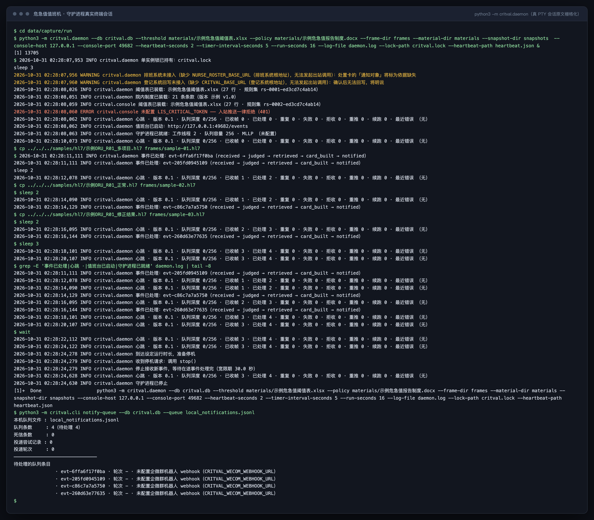
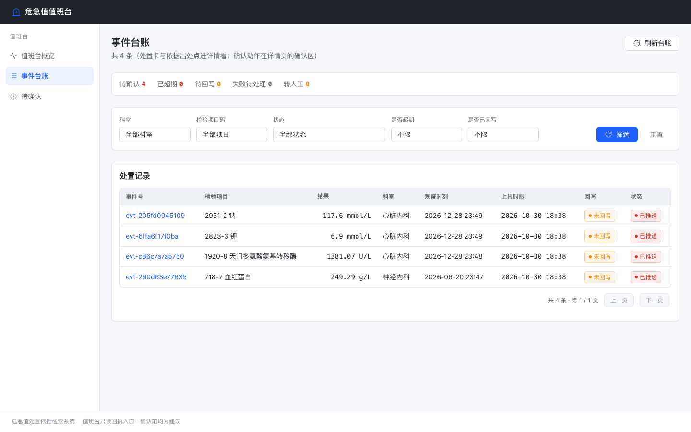
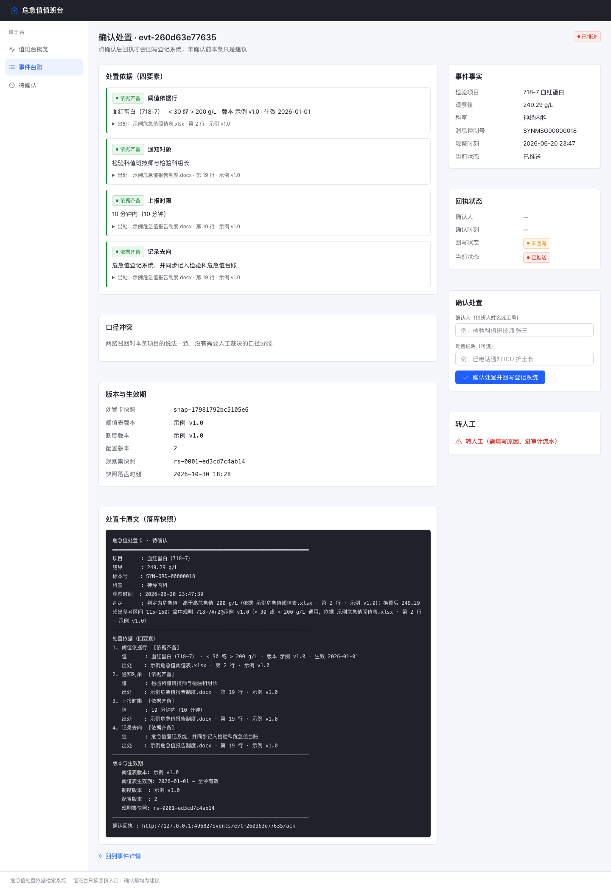
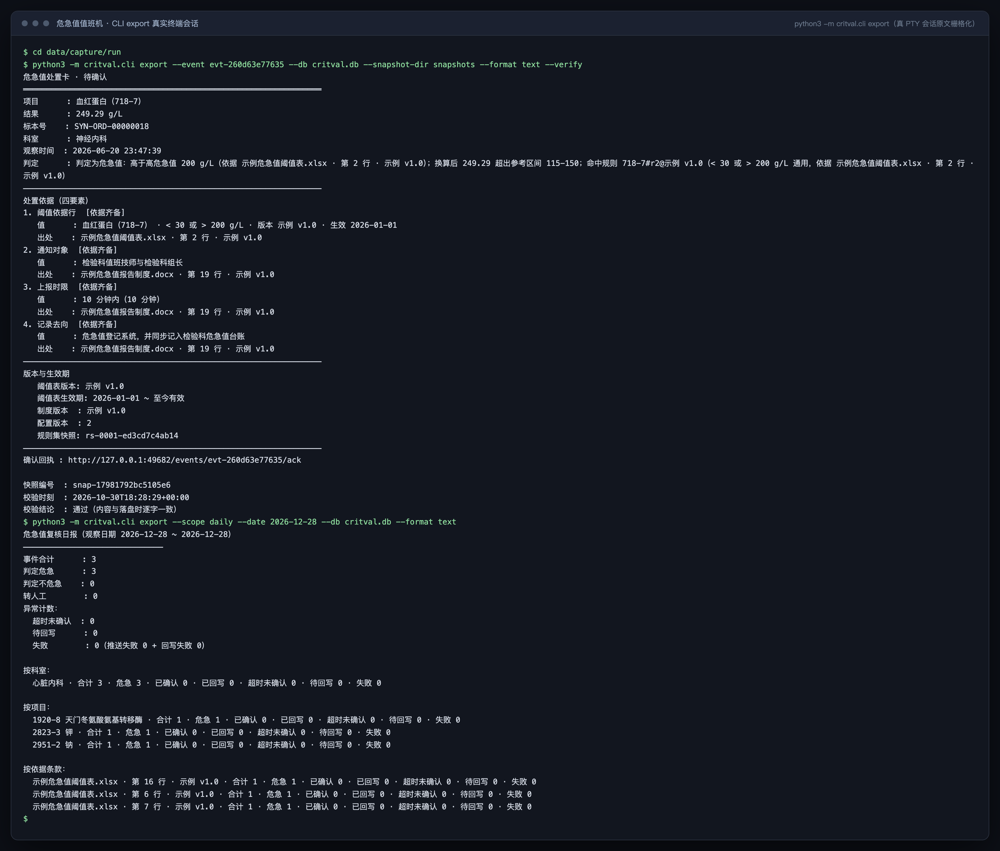

# 危急值处置依据检索系统

> 一条危急值结果从 LIS 推过来的当下，系统按院内阈值表判定危急、召回院内危急值报告制度条款、从排班系统取当班人，当场装出一张**带出处的处置卡**（阈值依据行 / 通知对象 / 上报时限 / 记录去向），推进值班群；值班人在值班台点确认后，回执按消息控制号幂等回写院内危急值登记系统，全程留台账与审计。

危急值处置之所以要人翻表、翻文件、打电话，慢只是其次，关键是**「凭什么」没有当场固定下来**：值班人说的「Hb 62 危急」对上阈值表第几行、上报时限几分钟、记录交回哪里，往往各凭各的记忆。本系统把这一步固化成一条常驻链路——四件事凑齐成一张卡，四件事**各带出处**（文件名 + 行号 + 版本号），推给当班人；只有当班人点确认，卡片才回写成登记系统里的已生效事实。

---

## 适用场景 / 目标岗位

| 岗位 | 什么时候用 | 得到什么 |
|------|------------|----------|
| 检验科值班技师 | 危急值结果出来的当下，夜班一个人盯着一台仪器 | 一张写明「命中阈值表第几行、通知哪个科室的谁、几分钟内上报、记录交回哪里」的处置卡，附带出处行号，不用翻表翻文件 |
| 临床科室护士长 | 值班群弹出危急值通知，需要马上决定谁去处理 | 卡片里直接写清当班人姓名与岗位、时限分钟数、记录交回哪个科室/系统，不用凭经验口口相传 |
| 检验科组长 / 质控专员 | 次日复核台账，想确认「昨天那条是按哪条依据通知的」 | 台账可按科室、项目、依据条款、时限、状态筛选，能筛出超时未确认、待回写、失败三类异常并导出给质控 |
| 检验科组长 | 阈值表改版签发前，想看清这版改了什么 | 一张改版影响面清单：哪些项目新增、哪些删除、哪些判定门槛变了，逐条标出「历史判定需复核」；改版窗口内还能查出此刻该用哪一版、有没有版本空档 |
| 医务科 | 危急值报告制度改版签发前，想看清处置动作变了哪几条 | 条款级改版清单：新增 / 删除 / 通知对象、上报时限、记录去向有变化；未读懂的段落逐条列出来等人确认，不编、不跳 |
| 信息科 | 值班台跑了一整周，想知道某条事件在哪一步停下、为什么 | 事件全链路可回放（逐节点轨迹 + 审计流水），运维 CLI 可查库完整性、状态分布与待办计数 |

---

## 能力要点

- **危急判定以院内阈值表为唯一权威**，不是以 LIS 的异常标志为准：LIS 标了异常但阈值表没越限时，记录口径分歧并以阈值表为准；阈值表越限时即便 LIS 漏标也会判危急。
- **每一条结论都带出处**：阈值依据行写明是哪个文件、第几行、第几版；制度条款写明文件指纹、段落序号与章节路径，复核时能翻回原始材料对得上。
- **单位不认得就不判**：查不到换算关系的观察值一律标「单位未知」转人工，绝不按经验猜一个系数把临界值判反；参考区间按性别、年龄段分档选。
- **「凭什么是危急值」能一步步复算**：判定过程落成七段记录（原值 → 换算 → 命中哪条规则 → 阈值行是哪份文件第几行 → 与 LIS 异常标志是否对得上 → 结论），按事件 ID 回放一次就**重跑一遍**判定并与当时落库的记录逐字段比对。
- **四要素缺一项就标缺项，不编内容**：找不到依据行、没召回到条款、排班系统不可用，卡片上对应位置明写缺什么、为什么缺，并注明走了哪一级降级。
- **建议与事实之间隔一道人工确认**：判定与检索产出的一律是「待确认的建议」；只有值班人点确认，回执才回写登记系统成为已生效事实，未确认的卡片停在「已推送待回执」并到期复查重推。
- **口径分歧摊开给人裁决**：阈值行与制度条款给出不同时限、通知对象或危急阈值时，系统不替它选一个——各方取值与各方出处一起摆到值班台待裁决区，卡片上相关要素在裁决前不算「已解决」。
- **阈值表改版有影响面可查**：改版前跑一条命令，看清哪些项目的判定门槛变了、哪些数值区间会翻转结论，并列出历史事件用新口径重算后的翻转清单——**历史台账一行不改**，更正历史由人另开处置流程。

---

## 快速开始

### 依赖

- Python ≥ 3.10（推荐 3.11 及以上）；macOS / Linux，Windows 建议用 WSL。**零外部中间件**：不需要 Elasticsearch、MySQL、Redis、MinIO 或任何模型服务；持久化用 SQLite，单机一台检验科值班机即可部署；仅 4 个纯解析依赖：`openpyxl`（阈值表 xlsx）、`python-docx`（制度 docx）、`pypdf`（制度 pdf，可选）、`pytest`（测试）

### 安装

```bash
cd critical-value-citation && python3 -m venv .venv && source .venv/bin/activate   # Windows: .venv\Scripts\activate
pip install -r requirements.txt
```

### 配置

复制 `.env.example` 为 `.env` 并按院内实际填写；所有凭据位**只能**从环境变量读，代码里不出现密钥。

```bash
cp .env.example .env
export CRITVAL_WECOM_WEBHOOK_URL="https://qyapi.weixin.qq.com/cgi-bin/webhook/send?key=xxxx"
export CRITVAL_BASE_URL="https://his.example-hospital.local"   # 登记系统
export CRITVAL_TOKEN="由院内分配的登记系统令牌"
export NURSE_ROSTER_BASE_URL="https://roster.example-hospital.local"   # 排班系统
export ROSTER_TOKEN="由院内分配的排班系统令牌"
export LIS_CRITICAL_TOKEN="与 LIS 约定的共享令牌"
export CONSOLE_TOKEN="值班台访问令牌"
```

> `.env` 已在 `.gitignore` 中，不会被提交。全部配置项见下表与 `.env.example`。

### 构建与验证

```bash
# ① 启动常驻服务（产品的运行主路径，同进程带值班台）
python -m critval.daemon
#    浏览器打开 http://127.0.0.1:8760/events —— 首屏是事件台账页，顶部五个待办桶（待确认 / 已超期 / 待回写 / 失败待处理 / 转人工）各带数。停机：Ctrl-C。

# ② 跑测试套件
pytest -q

# ③ 一条命令跑通全链：安装自检 → 起守护 → 投递材料与样例危急值 → 判定 → 处置卡 → 落盘 → 导出
bash scripts/demo.sh
python3 scripts/e2e.py

# ④ 离线安装自检（装不上 / 配置位缺了 / 目录不可写，在这里一次看全）
python3 scripts/check_install.py
```

### 主命令速查

```bash
python -m critval.daemon                  # 常驻守护：监听 → 判定 → 出卡 → 推送 → 等确认
python -m critval.cli console-serve --port 8760   # 值班台服务承载（含入站 HTTP 推送端点）
python3 scripts/demo.sh                   # 一条命令跑通「安装自检 → 投递 → 判定 → 出卡 → 落盘 → 导出」
python3 scripts/check_install.py          # 离线安装自检：依赖 / 配置位 / 目录权限 / 台账库可写
python3 scripts/e2e.py                    # 端到端复核：ER7 帧 → 判定 → 出卡 → 落 SQLite 台账
python -m critval.cli probe --item 718-7 --value "25 g/dL"   # 试判 + 试检索：结论与阈值依据行 / 导出复核台账
```

---

## 命令 / API / 配置说明

### 关键配置项

| 配置项 | 默认值 | 说明 |
|--------|--------|------|
| `CRITVAL_WECOM_WEBHOOK_URL` | 空 | 企业微信群机器人 webhook，值班群推送通道；为空时降级为本机通知队列，事件不丢 |
| `CRITVAL_BASE_URL` / `CRITVAL_TOKEN` / `NURSE_ROSTER_BASE_URL` / `ROSTER_TOKEN` | 空 | 院内危急值登记 / 护理执行平台与排班 / 值班名单系统的基地址与 Bearer 凭据；只从环境变量读，日志与快照中脱敏 |
| `LIS_CRITICAL_TOKEN` / `LIS_MLLP_BIND` | 空 | LIS 推送回调共享令牌（常量时间比较）与 MLLP 监听地址端口（形如 `0.0.0.0:2575`） |
| `CRITVAL_LISTEN_BASE_URL` | `http://127.0.0.1:8760` | 本系统对外监听地址（LIS 推送回调目标 + 值班台入口） |
| `CONSOLE_TOKEN` | 空 | 值班台页面与确认接口的访问令牌；未配置时本机直开，远程访问一律 401 |
| `CRITVAL_DB_PATH` | `./data/critval.db` | SQLite 台账 / 审计 / 幂等键库文件位置 |
| `CRITVAL_THRESHOLD_PATH` / `CRITVAL_POLICY_PATH` | 仓库内示例材料 | 院内危急值阈值表 xlsx（判定权威）与危急值报告制度（召回依据）；**院内上线必须换成院内文件** |
| `CRITVAL_MERGE_WINDOW_SECONDS` / `CRITVAL_NOTIFY_MAX_ATTEMPTS` / `CRITVAL_LOCK_PATH` | `300` / `3` / `./data/critval.lock` | 多项目合并成一张卡的时间窗（秒）；单轮投递最多尝试几次（超出即落死信，事件不丢）；单实例锁路径——同一数据目录只允许一个守护进程，第二个实例报错退出（退出码 3） |

> 其余配置项（材料目录、快照目录、队列容量、并发数、日志轮转、限流、体积上限等）见 `.env.example` 与 [`docs/cli.md`](docs/cli.md)。

### CLI 子命令 / 接口端点

| 命令或路径 | 用途 | 关键参数 |
|------------|------|----------|
| `python -m critval.daemon` | **常驻守护进程（运行主路径）**：MLLP 监听 + 目录投递 + 定时器三路事件源汇入有界队列，并发处理（判定 → 出卡 → 推送），周期心跳；同进程挂值班台与入站推送端点；停机时处理完在途事件再退，重启后按台账状态续跑不重复推送 | `--db`、`--threshold`、`--policy`、`--mllp-bind`、`--console-port`、`--workers`、`--queue-size` |
| `python -m critval.cli console-serve` | 只起值班台服务承载（常驻进程）：同进程提供入站推送端点与值班台页面 | `--host`、`--port`、`--db`、`--threshold` |
| `critval ingest` | 材料与报文入库：解析阈值表 / 制度出报告，批量灌 ER7 帧；`--dir` 批处理模式默认启用断点续跑游标 | `--threshold`、`--policy`、`--frames`、`--dir`、`--cursor` |
| `critval probe` | 试检索回放（不落库、不改状态）：摆出参与召回的材料版本与候选、得分、命中路与出处定位；`--item` + `--value` 额外按同一份阈值表试判 | `--item`、`--item-code`、`--value`、`--unit`、`--at`、`--query`、`--top-n` |
| `critval bind` / `version-check` / `policy-summary` / `policy-diff` | 版本绑定表与改版体检（生效版本 / 版本空档 / 口径冲突）；制度解析摘要与改版影响面（条款级条目、未识别行清单、字段缺失清单） | `--list`、`--derive`、`--at`、`--policy`、`--old`、`--new` |
| `critval recall` / `recall-merge` / `recall-fallback` / `recall-conflict` | 混合召回引擎：两路融合 → 硬闸门 → 规则重排；合并归一化；分级降级；双路差异归因 | `--threshold`、`--policy`、`--query`、`--item-code`、`--top-k`、`--top-n` |
| `critval export` | 导出处置卡快照原文或复核台账（日报 / 周报，text / csv / xlsx） | `--event`、`--format`、`--scope`、`--date`、`--out`、`--verify` |
| `critval reconcile` / `writeback-retry` | 台账 ↔ 登记系统回执对账（默认只读，产出四类差异）与显式补写失败回执 | `--db`、`--out`、`--event`、`--resolve`、`--actor`、`--list` |
| `critval doctor` / `audit-verify` / `audit-stats` / `ledger-trace` / `trace` / `judge-replay` | 库体检、审计链自检、审计统计、四问溯源、处置链回放、判定回放 | `--db`、`--event`、`--export` |
| `critval kb-watch` / `parse-queue` / `rules-summary` / `rules-reload` / `config-check` | 投递目录扫描与材料重建；材料解析人工确认队列；规则集摘要与热载入；启动自检 | `--dir`、`--apply`、`--queue`、`--threshold`、`--json` |
| `GET /events` · `/events/{id}` · `/events/{id}/ack` | 值班台三页（服务端渲染）：事件台账、事件详情、处置卡确认页；筛选与复核报表同一套查询 | `dept`、`item`、`status`、`overdue`、`written_back`、`page` |
| `POST /events/{id}/ack` · `transfer` · `replay` | 值班人确认 / 转人工 / 补写回写；转人工与补写的原因必填，页面另有站内二次确认模态框 | 表单体：`handler`、`note`、`reason` |
| `POST /api/v1/critical-value-events` · `GET /api/v1/local-notifications` · `/healthz` · `/api/events` | 入站推送回调（LIS 推给我们）/ 值班台可见本机队列（需值班台凭据）/ 健康检查（不含业务数据，不设凭据）/ 台账列表 JSON | 体含 `event_id` / `item_code` / `value` / `unit` / `critical_level` / `raised_at` / `dept_code`；查询参数 `dept`、`item`、`status`、`page` |

### 错误与降级

| 场景 | 表现 | 处理方式 |
|------|------|----------|
| 命令行参数写错 / 命令中途失败 | argparse 报用法错误，或 stdout 不是完整 JSON | 参数错退 `2` 且指明缺哪个参数；失败信息走 stderr，stdout 仍是一个可解析的 JSON 文档（`ok=false`、`exit_code=1`） |
| 观察值单位查不到换算关系 / 制度条款一条都没召回 | 出不了判定结论、出不了时限与去向 | 单位查不到换算就标「单位未知」；召回为空则不产出任何引用——两者都转「转人工」并留审计，不猜系数、不编依据 |
| LIS 异常标志与院内阈值表口径对不上 | 两边说法不同 | **以阈值表为准**，同时留一条口径分歧记录（带命中阈值行的文件与行号） |
| 阈值表路径配了但文件读不到 | 判定会直接转人工 | 值班台显式报错（错误码 `threshold_unbound` + 怎么办 + 重试入口），不让值班人对着空台账以为今天没事 |
| 排班系统不可用 / 凭据不对 | 取不到当班人 | 降级为带时间戳的缓存，卡片标注「当班名单来源：缓存（时间戳）」；缓存过期仍不可用则转人工 |
| 值班人还没确认就想回写登记系统 | 未确认的回执会变成已生效事实 | **一次出站调用都不发**（出站请求数为 0），只回报「当前状态不允许回写」 |
| 回写体不合契约 / 内容与既有事实冲突 | 登记系统那边多半是定长列与枚举列 | 契约闸门逐字段校验，不过就**一个字节都不发**；幂等冲突**不覆盖**既有事实，事件转「转人工」 |
| 值班台台账空着 / 凭据缺失或不匹配 | 分不清是「今天没危急值」还是「链路没通」；页面拿不到台账 | 空态说清这可能是哪一种空并逐条列排查项；凭据不对回 `401` + 提示怎么带，未配 `CONSOLE_TOKEN` 则本机直开 |
| 企微推送失败 / 对账时登记系统连不上 | 值班群收不到；回执一条都读不到 | 推送侧按指数退避重试（凭据错不重试），仍推不出去则落**本机通知队列**、事件不丢；对账侧**报错退出**，不出一份「远端没有」的假清单——查不到 ≠ 没有 |

### 对接现有系统

本系统的集成面是**四个真实通道**，凭据全部取自环境变量，代码内不出现密钥：

| 方向 | 对端系统 | 协议 | 读写 | 凭据位 |
|------|----------|------|------|--------|
| 入站（主 / 辅） | LIS 检验系统 | HL7 v2 `ORU^R01` over MLLP（帧以 `\x0b` 起、`\x1c\r` 止）；辅通道 HTTP `POST /api/v1/critical-value-events` | 读 | MLLP 会话本身承载，无独立凭据；辅通道用 `LIS_CRITICAL_TOKEN`（常量时间比较） |
| 出站（写） | 企业微信群机器人 | HTTPS webhook，Markdown 消息体 | 写 | `CRITVAL_WECOM_WEBHOOK_URL` |
| 出站（写） | 院内危急值登记 / 护理执行平台 | HTTP `POST /api/v1/critical-events` | 写 | `CRITVAL_TOKEN` |
| 出站（读） | 排班 / 值班名单系统 | HTTP `GET /api/v1/duty-roster` | 读 | `ROSTER_TOKEN` |

另有**材料投递面（补充）**：院内危急值项目阈值表（xlsx）与危急值报告制度（docx / pdf）放入共享目录即可，目录变更触发增量入库与索引重建。**测试替身的边界**：`tests/fixtures/` 下的脱敏样例与本地协议替身**仅用于测试数据层**，**不是最终集成面**；仓库内 `samples/` 小样例的阈值数值取自公开文献常见参考区间，**不代表任何医院标准**，院内上线必须以本院危急值标准文件为准。全部子命令、端点与参数见 [`docs/cli.md`](docs/cli.md)。

---

## 典型场景

### 场景 1：夜班值班技师收到一条血红蛋白危急值

1. 值班群收到处置卡：命中阈值表第几行、通知哪个科室的谁、几分钟内上报、记录交回哪里，四条各带出处行号；值班人在值班台打开确认页复核——**左栏是依据**（四要素 + 出处 + 口径冲突 + 版本 + 卡原文），**右栏是动作**（事件事实 / 回执状态 / 确认 / 转人工折叠区）。
2. 点确认 → 回执按消息控制号幂等回写登记系统；没填确认人服务端直接拒（400），重复确认不产生第二条回执。

### 场景 2：检验科组长次日复核台账

1. 值班台事件台账页按科室 / 项目 / 依据条款 / 时限 / 状态筛选，筛出超时未确认、待回写、失败三类异常；导出一份复核材料：明细表（每条事件一行）+ 汇总表（按科室 / 项目 / 依据条款三个视角分组计数），口径与值班台筛出来的**完全一致**——两处用的是同一套查询。

### 场景 3：信息科排查「昨天那条为什么没回写」

1. 跑一次只读对账：按消息控制号比对本地台账与登记系统回执，产出四类差异清单，每行给建议动作（补写 / 重放 / 标记人工处理）；对账**不改状态、不发写请求、不写审计**，登记系统连不上时直接报错、不出假清单。
2. 要处理必须显式写明处理人，每一次处理都留审计。

### 场景 4：检验科组长签发新一版阈值表之前

1. 跑改版影响面：哪些项目新增 / 删除、哪些判定门槛变了、**哪些取值区间会翻转结论**；再把台账里的历史事件用新口径重算一遍，列出结论翻转与新口径判不出两张清单。
2. **历史台账一行不改**——重算只产出复核清单并给出重算前后的台账指纹作证，更正历史由人另开处置流程。

### 场景 5：医务科签发新一版危急值报告制度之前

1. 解析制度到条款级：识别条款数、未识别行清单、字段缺失清单、版本生效期；再跑改版影响面：哪几条改了、删了、新增了，事实要素（时限 / 去向 / 通知对象）变没变。
2. 版本绑定后只召回被绑版本。

### 场景 6：夜班值班机常驻 —— 危急值一来就有人接

1. 值班机上起守护进程（同进程起值班台），浏览器打开 `http://127.0.0.1:8760/events`；值班人在台账页看到待确认桶有几个未处理，点进去打开确认页 → 点确认 → 回执幂等回写登记系统；机器半夜重启过也不要紧——重启后按台账状态续跑，不重复推送。事后问「这条卡在哪一步、为什么」，一条命令回放**当时落库的轨迹**：停在哪一步、为什么停、这一环能不能重跑。

> 其余场景（召回参数扫描、判定基线对比、审计链自检、并发与崩溃恢复等）见 [`docs/examples.md`](docs/examples.md)。

---

## 输出样例

以下片段均为**真实运行产物**（跑它的命令就写在标题里），完整清单见 [`docs/examples.md`](docs/examples.md)。

### 一条命令跑通全链（`bash scripts/demo.sh`）

真实输出摘录（⓪ 安装自检 → ① 投递 → ② 帧 → ③ 事件 → ④ 判定 → ⑤ 处置卡 → ⑥ 导出）：

```text
⓪ 安装自检：阻断项 0 项 · 提醒项 10 项 · 依赖就绪，可以继续
③ 台账里已经有事件：evt-205fd0945109
④ 判定结果（台账里已落库的事实）
   · 钠 117.6 mmol/L → critical｜判定为危急值：低于低危急值 120 mmol/L（依据 示例危急值阈值表.xlsx · 第 7 行 · 示例 v1.0）
   · 钾 6.9 mmol/L → critical｜判定为危急值：高于高危急值 6.5 mmol/L（依据 示例危急值阈值表.xlsx · 第 6 行 · 示例 v1.0）
⑤ 处置卡（值班群原文 · 离线纯文本）：处置依据四要素 —— 阈值依据行 / 通知对象 / 上报时限 / 记录去向，各带「文件名 · 第 N 行 · 版本」出处；快照校验结论：通过（内容与落盘时逐字一致）
⑥ 复核台账导出：data/demo/复核台账_日报.csv（次日复核明细）+ _汇总.csv
```

### 事件台账与复核日报

`python -m critval.cli export --scope daily --date 2026-10-29 --format text` 的真实输出（末行为合计与三类异常计数）：

```text
事件号              项目   结果        科室  观察时刻           上报时限  回写   状态
evt-20261029-0001   718-7  62 g/L      ICU   2026-10-29 23:41  15 分钟  已回写  已归档
evt-20261029-0002   282-3  6.2 mmol/L  ICU   2026-10-29 23:52  10 分钟  待回写  已推送待回执
evt-20261029-0003   6690-2 3.1 %       ICU   2026-10-30 01:05  30 分钟  未回写  待确认
合计 3 条｜超时未确认 1 条｜待回写 1 条｜失败 0 条
```

**台账四问**（`ledger-trace`，按哪条依据 / 通知了谁 / 几分钟内 / 谁确认的）：`示例危急值阈值表.xlsx 第 12 行（v1）` → `ICU / 李××（主责）` → `15 分钟` → `李×× / 2026-10-29 23:44`；**审计链自检**（`audit-verify`）：链完好退出码 0，断链非零退出并报出首个断链位置。

---

## 概念 / 实测对照

### 视觉目标

结构化视觉目标卡见 [`docs/concepts/visual-goal.md`](docs/concepts/visual-goal.md)：值班台首屏（空态）、处置卡确认页（四要素分区 + 出处角标 + 状态徽标）、事件台账页（密集表格 + 筛选 + 语义色徽标）三个状态的配色、字号层级、8px 间距栅格与留白密度。该卡写明了必须可达的约束（内联 SVG 图标、无 emoji、服务端模板 + 原生 CSS、无前端构建链），所描述元素都能由本项目依赖真实渲染出来。

### 实测证据

真实运行截图采集到 `docs/screenshots/`。下面四张来自**同一次真实运行**：值班机上起守护进程，往帧投递目录丢三份检验结果帧，守护进程收单 → 判定 → 召回 → 出卡 → 推送，随后值班台开页面、运维用 CLI 导出复核材料，共 4 条事件入台账。

- **守护进程真实终端会话**（心跳 + 事件处理链 + 推送记录；「未配置企微群机器人 webhook」是**真实的降级**，采集时凭据位一律清空，不连任何院内系统）：
- **值班台事件台账页**（概览条五个待办桶 + 五维筛选 + 八列明细表，状态徽标带中文文字）：
- **处置卡确认页**（左栏四要素逐条带出处「文件 · 第 N 行 · 版本」，右栏事件事实 / 回执状态 / 确认动作 / 转人工折叠区）：
- **CLI 导出复核材料**（上为按事件取回的处置卡快照原文并校验指纹，下为按观察日期切的复核日报）：

三态与交互反馈（加载态骨架屏、空态、错误态、转人工 toast、二次确认模态框）另有截图，见 [`docs/screenshots/`](docs/screenshots/)；两张终端图的**逐字原文**另存于 `docs/examples/terminal_session_*.txt`。重新采集用 `python3 scripts/capture_screenshots.py --out docs/screenshots`（需要 Playwright + Chromium；**跑不通就报错退出，不产出占位图**）。

> **诚实标注**：上侧是**视觉目标**（设计意图），下侧是**实测证据**（真实运行产物）。目标与实现在视觉上必然有差距——徽标尺寸、骨架屏块高、筛选表单换行位置等细节会与目标卡不完全一致；本项目**不生成事后效果图**去抹平这份差距。已知差距：目标卡写的是「值班台首屏（空态）」，而实测首屏是**有数据**的台账（跑一次就有 4 条事件），空态另有专门一张截图；导出终端图是 200 列宽的终端，值班机上真实窗口宽度可能不同，折行位置会不一样。

---

## 架构与数据流

```
   LIS ──MLLP / HTTP 推送──┐  材料共享目录 ──阈值表 xlsx · 制度 docx──┐
                            ├──► 事件规范化（幂等键）                   │
                            │        ▼                                ▼
   排班系统 ──duty-roster───┼──► judge 危急判定（权威 = 院内阈值表）→ retrieve 混合召回
                            │        · 单位换算 → 分档 → 双阈值比较    （结构化精确 × BM25 融合
                            │        · 交叉校验 + 七段判定链留痕      → 硬闸门 → 规则重排 → 带出处）
                            └──► 差异归因 → card 处置卡（四要素 + 出处 · 版本闸门）──► flow 处置链
                                                                                          │
   notify 推送（企微 webhook · 退避重试 · 死信 · 重复抑制）────────────────────────────┤
                                                                                          ▼
   登记系统 ◄── 幂等回写（message_control_id）◄── 值班人点确认 ◄── 值班台（浏览器，同进程）
                                                                                          │
   ledger 台账 / 状态机 / 只追加审计 ◄── 每次状态迁移 ─────────────────────────────────┘
        └──► writeback 对账（只读 → 四类差异清单，显式 --resolve 才处理）
```

完整数据流、状态机跃迁表、审计链语义与逐文件职责注释的完整目录树见 [`docs/architecture.md`](docs/architecture.md)。

### 关键不变量

- **幂等键**：事件幂等键 = `MSH-10 + OBX-3 + OBX-14`；回写幂等键 = `message_control_id`。重复帧只处理一次，重复回写不产生第二条记录，既有事实不被覆盖。
- **状态跃迁受控**：主链 `received → judged → card_built → notified → acknowledged → registered → archived`，分支态 `not_critical` / `pending_ack` / `failed` / `writeback_failed` / `superseded` / `transferred_to_human`；非法跃迁被拒绝并记审计，终态不可静默回退。
- **审计只追加且可证明未被改动**：审计流水由库级触发器锁成只追加，且每条盖「本条内容哈希 + 上一条的链哈希」，逐条重算即可判定链是否被动过，并指出第一个断链位置。
- **人工确认不可绕过**：未经值班人确认的事件，出站回写调用次数恒为 0。
- **失败不静默改数据**：单位未知、依据缺失、召回为空、版本空档、幂等冲突一律转人工或落明确失败态，绝不写一个「看起来对」的结论；同一张卡里也不得同时出现阈值表的新旧两版，与院内版本绑定不符不出卡（报 `version_mismatch`）。
- **患者可识别信息不落库**：患者标识只透传到事件标识层用于去重，姓名、身份证、住院号既不落库也不进卡片与推送载荷。

---

## 安全与合规边界

- 本系统**不做诊断、不给治疗建议、不自动签名或代签**；它只负责把「依据与出处、通知对象、上报时限、记录去向」四件事摆清楚，处置决定权始终在人手里。
- **不落患者姓名、身份证、住院号**：患者标识只用于事件去重，既不写台账也不进处置卡与推送载荷；审计流水只落标本号、项目码、时间、科室、角色。
- **只读入站、不写回 LIS**：系统从 LIS 侧只接收危急值推送，不向 LIS 写任何数据；出站只写「院内危急值登记 / 护理执行平台」与值班群，不代签、不代录医嘱；**全部凭据从环境变量读取**，代码内不出现密钥，日志与配置快照中的令牌脱敏展示，值班台接口需访问令牌（不做院内 SSO 对接）。

---

## 验收与自检

| 验收项 | 命令 | 期望结果 |
|--------|------|----------|
| 值班台三页与确认动作 | `pytest tests/test_daemon.py -q` | `/events` 列出事件、`/events/{id}` 给依据出处、`/events/{id}/ack` 给确认表单；缺确认人 → 400；确认 → 真 HTTP POST 回写登记系统 → 状态 `archived`；重复确认**不产生第二条回执** |
| 值班台三态与写操作反馈 | `pytest tests/test_console_states.py -q` | 加载 / 空 / 错误各有独立模板且互斥；确认绿 / 失败深灰 / 转人工琥珀；破坏性操作走站内模态框且原因必填 |
| 幂等与并发 | `pytest tests/test_idempotency.py tests/test_concurrency.py -q` | 8 线程同收一帧 → 台账 1 行、恰好 1 路拿到新事件；5 个真进程同投一帧 → 台账仍 1 行；库完整性 `PRAGMA integrity_check` 通过 |
| 审计链可自检、断链可定位 | `python -m critval.cli audit-verify --db data/critval.db` | 链完好退出码 0；篡改 / 删行后退出码非 0，并报出首个断链的流水号与坏在哪一种 |
| 四问从已落库事实里答得出来 | `python -m critval.cli ledger-trace --event <id> --db data/critval.db` | 输出按哪条依据（文件名 + 行号 + 版本）/ 通知了谁 / 几分钟内 / 谁确认的；答不上来的明说「没记录」 |
| 未确认零回写 | `pytest tests/test_writeback.py tests/test_writeback_contract.py -q` | 未确认事件的出站调用次数为 0；契约不合法时**一个字节都不发**；幂等冲突**不覆盖**既有事实 |
| 对账只读、差异不自动抹平 | `pytest tests/test_reconcile.py -q` | 只读对账后台账逐行不变、审计条数不变、对端零次 POST；查不到 ≠ 没有，对端不可达直接报错 |
| 处置链能跑通也能停 | `pytest tests/test_flow_dsl.py tests/test_flow_pipeline.py tests/test_node_contracts.py -q` | 缺参节点不跑且后续节点也不跑；`a → b → a` 抛回路错误；注入节点异常后事件落 `转人工` 且审计留痕 |
| 判定可复算、单位不认得就不判 | `pytest tests/test_judge.py tests/test_units.py tests/test_judge_explain.py -q` | 缺换算的观察值标「单位未知」并转人工；判定链与落库记录逐字段一致；判定记录里搜不到患者明细 |
| 召回为空不编依据 | `pytest tests/test_retrieve_fallback.py tests/test_citation.py -q` | 降级到第 3 级时引用数为 0、事件转「转人工」；每条引用带 sha256 + 段落序号 + 章节路径 + 行号 + 版本 |
| 融合比单路强多少有数 | `pytest tests/test_recall_baseline.py tests/test_evaluate.py -q` | 纯 BM25 单路与融合引擎同材料同评测集同口径；命中 84.3% → 93.7%；出处覆盖率必须 100% |
| 阈值表改版影响面与历史重算 | `pytest tests/test_threshold_impact.py tests/test_version_diff.py -q` | 翻转值域算得出；只换生效期与单位写法不算口径变化；重算前后 events 行与审计表**逐字未变** |
| 入站两条通道同构 | `pytest tests/test_mllp.py tests/test_ingest_rest.py -q` | 同一条危急值走 MLLP 与走 REST 得到**同一个事件 ID**；粘包不丢帧、拆包不提前交帧 |
| 出站凭据全部来自环境变量 | `pytest tests/test_no_hardcoded_secret.py -q` | 源码无密钥字面量、无默认本机出站地址 |
| 实测证据不是设计稿 | `pytest tests/test_screenshots.py -q` | 四张采集产物都在且 > 10 KB；`docs/concepts/` 里没有图片；README 引用了这四张且写了诚实标注 |

---

## 项目结构

```
critical-value-citation/
├── README.md / LICENSE / requirements.txt / pyproject.toml / .env.example / qrcode.jpg / conftest.py   # 产品说明、MIT 许可证、4 个纯解析依赖、pytest 配置、凭据位样例（无密钥）、关注区块配图、pytest 根配置（把项目根放进 sys.path）
├── critval/                     # 产品源码（Python 包）
│   ├── daemon.py                # 常驻主循环：MLLP 监听 + 目录投递 + 定时器三路事件源 → 有界队列 → 并发处理 → 心跳；崩溃续跑与到期复查挂在这里
│   ├── config.py / models.py    # 环境变量配置面与运行时热载入 / 领域模型（事件 · 阈值行 · 条款 · Citation · 处置卡 · 台账）
│   ├── cli.py / cli_registry.py / cli_specs.py   # 运维 CLI 子命令族 + 统一 JSON 信封（command / ok / exit_code）与退出码
│   ├── hl7/ kb/ index/ retrieve/ judge/ card/    # 入站协议 · 材料解析与版本 · 索引 · 召回 · 判定 · 处置卡装配
│   ├── roster/ notify/ writeback/ ledger/        # 排班择人 · 推送可靠性 · 回写闸门与对账 · 台账状态机与审计
│   └── flow/ console/ runtime/                   # 处置链编排 · 值班台界面与三态 · 心跳锁与日志轮转
├── scripts/                     # 演示 / 数据获取 / 基准 / 对拍 / 调参 / 截图采集
│   ├── demo.sh / check_install.py / demo_card.py / e2e.py / ledger_demo.py / flow_demo.py / outbound_demo.py   # 一条命令跑通全链 · 离线安装自检 · 最窄主路径 · 入站端到端 · 台账闭环 · 处置链全链 · 三条出站通道
│   ├── fetch_data.py / gen_synth.py / build_materials.py / build_eval_set.py   # 公开数据抓取（断网降级）· Synthea 帧生成 · 示例材料 · 评测集生成
│   ├── tune_recall.py / compare_baseline.py / compare_judge_baseline.py / bench_ingest.py   # 参数扫描 · 两类基线对比 · 吞吐基准
│   └── capture_screenshots.py / bench_index.py / parse_matrix.py   # 实测截图采集（跑不通报错退出，不产出占位图）· 索引基准 · 方言对拍
├── samples/                     # 随仓库提交的小样例（HL7 帧 · 方言配置 · 阈值表 v1/v2 · 制度 · 排班名单 · 版本绑定表）
├── data/ reports/              # 可再生语料与运行期产物（已 gitignore，发布时不存在；scripts/fetch_data.py 可随时重建）
├── tests/                       # 测试套件（按模块就近；fixtures/ 是脱敏样例与本地协议替身，仅测试数据层）
└── docs/                        # 文档：cli.md（完整 CLI 与接口）· examples.md（全部输出样例）· architecture.md（完整数据流与目录树）
    ├── concepts/visual-goal.md / screenshots/  # 结构化视觉目标卡 / 真实运行截图（终端原文另存 examples/）
    └── operations.md / handover_checklist.md / material_spec.md / troubleshooting.md / dialect_matrix.md
```

> 逐文件职责注释的**完整目录树**见 [`docs/architecture.md`](docs/architecture.md)；目录树与仓库实际内容由 `pytest tests/test_project_tree.py -q` 自动核对（文档写了但文件没了、或清理漏下没交代的目录，都会报出来）。

---

## License

MIT

---

## 关注我们

欢迎扫码关注公众号，获取项目更新与交流加群：

